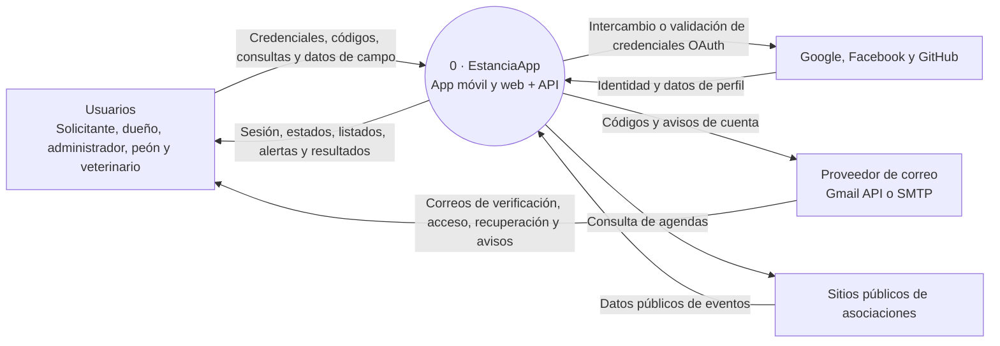
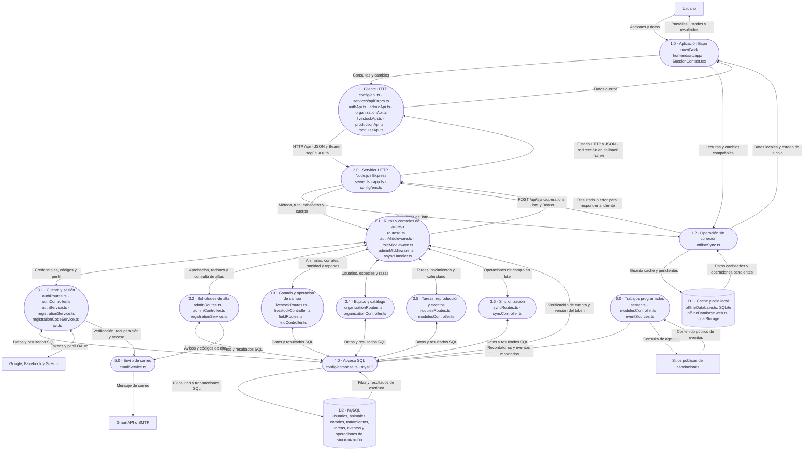
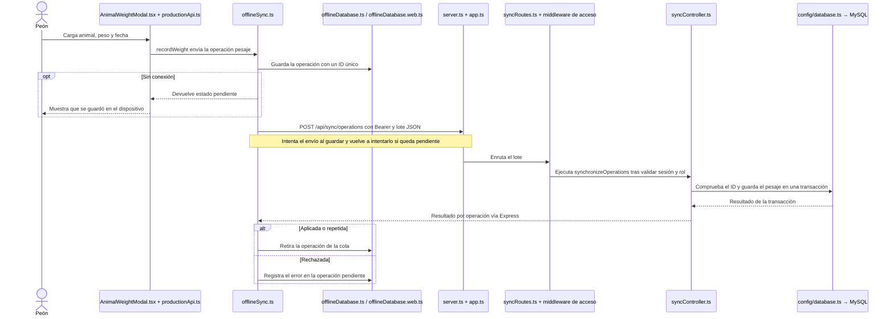

# DFD de EstanciaApp

## Nivel 0 · Contexto

## Nivel 1 · Solicitudes, servidor y almacenamiento

Los archivos de rutas, controladores, servicios y middleware de Express están en `backend/src/`. Los servicios de la aplicación están en `frontend/src/services/`.

- `backend/src/server.ts` inicia Express en el puerto configurado. En el arranque y luego periódicamente, genera recordatorios de nacimiento cada hora y consulta agendas externas cada siete días.
- `backend/src/app.ts` configura CORS, recibe JSON de hasta 5 MB, monta las rutas y concentra los errores que llegan al manejador global. `GET /api/health` devuelve el estado del proceso desde este archivo.
- En las rutas protegidas, `authMiddleware.ts` valida el token de acceso, consulta el estado de la cuenta y la versión del token en MySQL. Se aplican los permisos de `roleMiddleware.ts` o `adminMiddleware.ts` según la ruta. Las operaciones asincrónicas envueltas en `asyncHandler.ts` propagan fallas a Express.
- `backend/src/controllers/livestockController.ts` reúne `livestockController.animals.ts`, `livestockController.corrals.ts`, `livestockController.movements.ts`, `livestockController.nursing.ts` y `livestockController.notifications.ts`. Estos módulos comparten lógica en `livestockController.shared.ts`.
- En despliegue, `render.yaml` configura el servicio y su chequeo HTTP. `backend/package.json` define el inicio de `dist/server.js` y la ejecución de las migraciones mediante `backend/src/scripts/migrate.ts`.

## Nivel 2 · Ejemplo de ida y vuelta con un pesaje

La API también ofrece `POST /api/animals/:id/weights` en `fieldRoutes.ts`. El formulario actual usa la ruta de sincronización tanto con conexión como sin ella.

## Inventario de solicitudes HTTP

Los prefijos están montados en `backend/src/app.ts`. Los parámetros como `:id` se reemplazan por el identificador del recurso.

- `GET /api/health` — `app.ts`

### `authRoutes.ts` → `authController.ts`

- `POST /api/auth/login` → `login`
- `GET /api/auth/social/config` → `socialAuthConfig`
- `GET /api/auth/:provider/callback` → `socialOAuthCallback`
- `POST /api/auth/social/:provider` → `socialLogin`
- `POST /api/auth/refresh` → `refresh`
- `POST /api/auth/register` → `register`
- `POST /api/auth/verify-email` → `verifyRegistrationEmail`
- `POST /api/auth/resend-verification` → `resendRegistrationCode`
- `POST /api/auth/access-code` → `redeemAccessCode`
- `POST /api/auth/resend-access-code` → `resendAccessCode`
- `POST /api/auth/password-recovery/request` → `requestPasswordRecovery`
- `POST /api/auth/password-recovery/redeem` → `redeemPasswordRecoveryCode`
- `POST /api/auth/password-recovery/reset` → `completePasswordRecovery`
- `GET /api/auth/me` → `me`
- `PUT /api/auth/profile` → `updateProfile`
- `PUT /api/auth/password` → `changePassword`

### `adminRoutes.ts` → `adminController.ts`

- `GET /api/admin/registration-requests` → `listRequests`
- `POST /api/admin/registration-requests/:id/approve` → `approveRequest`
- `POST /api/admin/registration-requests/:id/reject` → `rejectRequest`

### `livestockRoutes.ts` → `livestockController.ts`

- `GET /api/animals` → `listAnimals`
- `POST /api/animals` → `createAnimal`
- `GET /api/corrals` → `listCorrals`
- `PUT /api/animals/:id` → `updateAnimal`
- `POST /api/animals/:id/deactivate` → `deactivateAnimal`
- `DELETE /api/animals/:id` → `permanentlyDeleteInactiveAnimal`
- `POST /api/corrals` → `createCorral`
- `PUT /api/corrals/:id` → `updateCorral`
- `DELETE /api/corrals/:id` → `deleteCorral`
- `POST /api/animals/:id/movements` → `moveAnimal`
- `GET /api/health/nursing` → `listNursingAnimals`
- `GET /api/health/animals/:id/records` → `listVeterinaryRecords`
- `POST /api/health/animals/:id/records` → `createVeterinaryRecord`
- `PATCH /api/health/animals/:id/status` → `updateNursingHealthStatus`
- `POST /api/health/animals/:id/discharge` → `dischargeNursingAnimal`
- `GET /api/notifications` → `listNotifications`
- `PATCH /api/notifications/:id` → `updateNotification`

### `fieldRoutes.ts` → `fieldController.ts`

- `GET /api/dashboard` → `dashboard`
- `POST /api/animals/:id/weights` → `createWeight`
- `POST /api/reports/:kind` → `createReport`
- `GET /api/deaths` → `reviewDeaths`
- `PATCH /api/deaths/:id/review` → `reviewDeaths`

### `organizationRoutes.ts` → `organizationController.ts`

- `GET /api/organization/users` → `listUsers`
- `PUT /api/organization/users/:id` → `updateUser`
- `DELETE /api/organization/users/:id` → `deactivateUser`
- `GET /api/organization/catalog` → `listCatalog`
- `POST /api/organization/catalog/species` → `createSpecies`
- `POST /api/organization/catalog/species/:id/breeds` → `createBreed`
- `DELETE /api/organization/catalog/species/:id` → `deleteSpecies`
- `DELETE /api/organization/catalog/breeds/:id` → `deleteBreed`
- `POST /api/organization/catalog/requests` → `requestCatalog`
- `PATCH /api/organization/catalog/requests/:id` → `reviewCatalog`

### `modulesRoutes.ts` → `modulesController.ts`

- `GET /api/tasks` → `listTasks`
- `POST /api/tasks` → `createTask`
- `PATCH /api/tasks/:id` → `updateTask`
- `GET /api/reproduction` → `listReproduction`
- `POST /api/reproduction/mating-services` → `createMatingService`
- `POST /api/reproduction/mating-services/:id/confirm-pregnancy` → `confirmPregnancy`
- `POST /api/reproduction/births` → `createBirth`
- `DELETE /api/reproduction/mating-services/:id` → `deleteMatingService`
- `DELETE /api/reproduction/births/:id` → `deleteBirthRecord`
- `GET /api/events` → `listEvents`

### `syncRoutes.ts` → `syncController.ts`

- `POST /api/sync/operations` → `synchronizeOperations`

